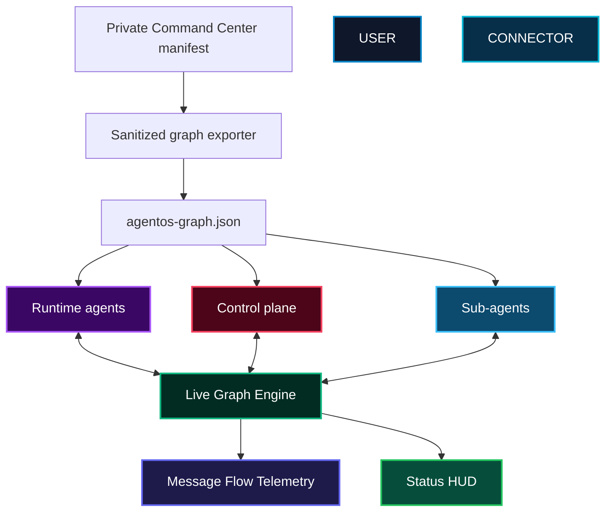

# ◈ ATSMATRIX // AGENT GRAPH — STINT-NET AgentOS Visualizer

[](https://anyel1to.github.io/ATSMATRIX-AGENT-GRAPH/)
[](https://opensource.org/licenses/MIT)
[](https://anyel1to.github.io/ATSMATRIX-AGENT-GRAPH/)
[](https://anyel1to.github.io/ATSMATRIX-AGENT-GRAPH/)
[](https://anyel1to.github.io/ATSMATRIX-AGENT-GRAPH/)

> **Visualize the real AgentOS roster and Command Center hierarchy.**
> This GitHub Pages application renders the sanitized `agentos-graph.json`
> exported from the private STINT-NET Command Center repository. It never
> receives private endpoints, tokens, instruction contents, or filesystem paths.

---

## 🌐 Live Web App
Experience the live agent graph in your browser:  
👉 **[https://anyel1to.github.io/ATSMATRIX-AGENT-GRAPH/](https://anyel1to.github.io/ATSMATRIX-AGENT-GRAPH/)**

---

## 📑 Table of Contents
1. [Core Features](#-core-features)
2. [Architecture Overview](#-architecture-overview)
3. [Source-of-truth synchronization](#-source-of-truth-synchronization)
4. [Developer Integration](#-developer-integration)
5. [Local Setup](#-local-setup)
6. [License & Credits](#-license--credits)

---

## ✨ Core Features

- **Live Agent Graph Canvas**: Physics-based node network with spring forces, orbital motion, and real-time message photons traveling between agents.
- **Repository-backed topology**: Agents, sub-agents, parents, roles, and capabilities come from the private Command Center manifest.
- **Command hierarchy**: Runtime, control-plane, and visibility-only sub-agents are visually distinguished.
- **Safe public projection**: The published snapshot excludes credentials, endpoints, instruction contents, and machine paths.
- **Zero-Dependency Single File**: Pure HTML5 + Canvas + CSS. Runs on GitHub Pages, Netlify, Vercel, or locally with zero build step.
- **Dark Cyber Aesthetic**: High-contrast research UI matching the ATSMATRIX visual language.

---

## 🏗️ Architecture Overview



---

## 🔗 Source-of-truth synchronization

The private repository owns `config/agentos.manifest.json` and the
`agent-graph:export` command. Its publish workflow creates a redacted snapshot
and updates this repository whenever the manifest changes.

Cross-repository automation requires a private-repository Actions secret named
`AGENT_GRAPH_PUBLISH_TOKEN` with contents write access limited to this public
repository. The token is never embedded in this site or exported JSON.

---

## 💻 Developer Integration

The renderer remains a zero-build static site. It loads:

- `index.html` — canvas graph and inspector
- `agentos-graph.json` — sanitized generated topology

Published snapshot shape:

```json
{
  "schemaVersion": 1,
  "source": { "repository": "…", "manifest": "…", "revision": "…" },
  "nodes": [{ "id": "hermes", "parentId": "commander", "kind": "runtime" }],
  "links": [{ "source": "commander", "target": "hermes", "type": "parent" }]
}
```

---

## 💾 Local Setup

```bash
git clone https://github.com/anyel1to/ATSMATRIX-AGENT-GRAPH.git
cd ATSMATRIX-AGENT-GRAPH
# Just open index.html in any modern browser
open index.html
```

No build tools. No dependencies. Pure frontend.

---

## 📜 License & Credits

MIT License © 2026 ATSMATRIX Technologies

Built by **ANYELO · ATSMATRIX**  
Part of the ATSMATRIX agent visualization suite alongside:
- [ATSMATRIX-HORIZON](https://github.com/anyel1to/ATSMATRIX-HORIZON)
- [atsmatrix-agent-visualizeR](https://github.com/anyel1to/atsmatrix-agent-visualizeR--ANYEL1TO)

📧 DM for inquiries · ATSMATRIX.COM
