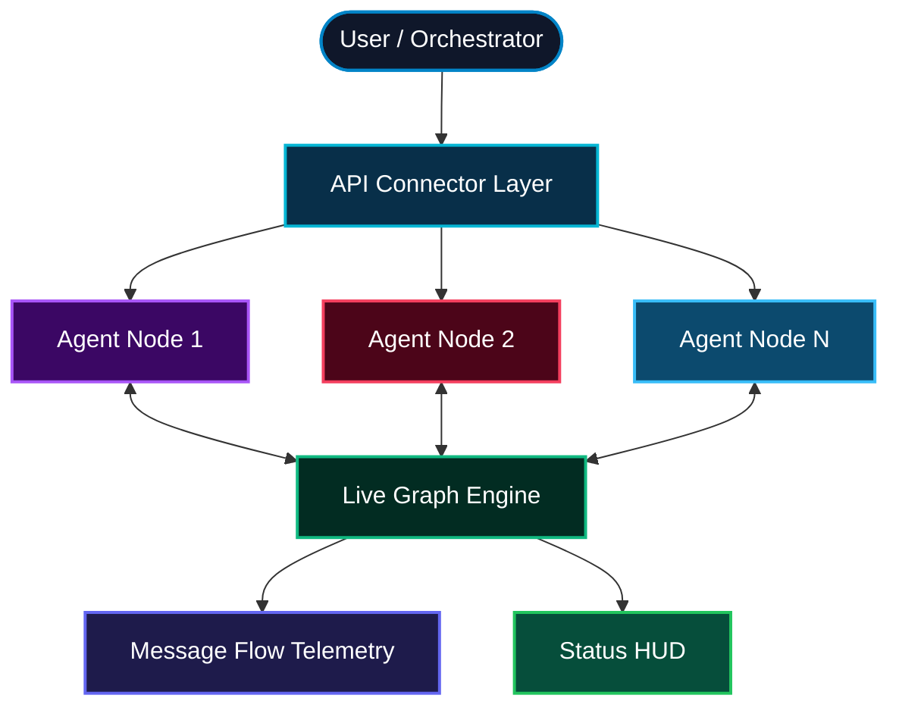

# ◈ ATSMATRIX // AGENT GRAPH — Multi-Agent Network & API Connector

[](https://anyel1to.github.io/ATSMATRIX-AGENT-GRAPH/)
[](https://opensource.org/licenses/MIT)
[](https://anyel1to.github.io/ATSMATRIX-AGENT-GRAPH/)
[](https://anyel1to.github.io/ATSMATRIX-AGENT-GRAPH/)
[](https://anyel1to.github.io/ATSMATRIX-AGENT-GRAPH/)

> **Connect any agent. Visualize the swarm. Watch intelligence emerge.**  
> **ATSMATRIX // AGENT GRAPH** is a professional multi-agent network visualizer and API connector built by **ATSMATRIX Technologies**. Plug in external agent endpoints (OpenAI, Anthropic, custom LangGraph, CrewAI, AutoGen, or your own), watch real-time message flows, and monitor reasoning graphs in a high-performance canvas engine.

---

## 🌐 Live Web App
Experience the live agent graph in your browser:  
👉 **[https://anyel1to.github.io/ATSMATRIX-AGENT-GRAPH/](https://anyel1to.github.io/ATSMATRIX-AGENT-GRAPH/)**

---

## 📑 Table of Contents
1. [Core Features](#-core-features)
2. [Architecture Overview](#-architecture-overview)
3. [How to Connect Your Agents](#-how-to-connect-your-agents)
4. [Developer Integration](#-developer-integration)
5. [Local Setup](#-local-setup)
6. [License & Credits](#-license--credits)

---

## ✨ Core Features

- **Live Agent Graph Canvas**: Physics-based node network with spring forces, orbital motion, and real-time message photons traveling between agents.
- **API Connector Panel**: Add any external agent by name + endpoint URL. Supports OpenAI-compatible, custom REST, webhook, and simulated agents.
- **Multi-Agent Topology**: Pre-built clusters (Discovery, Reasoning, Verification, Synthesis) that expand as you connect new endpoints.
- **Message Flow Telemetry**: Color-coded packet streams showing request/response cycles, latency, and success/failure states.
- **Zero-Dependency Single File**: Pure HTML5 + Canvas + CSS. Runs on GitHub Pages, Netlify, Vercel, or locally with zero build step.
- **Dark Cyber Aesthetic**: High-contrast research UI matching the ATSMATRIX visual language.

---

## 🏗️ Architecture Overview



---

## 🔗 How to Connect Your Agents

1. Open the live demo.
2. Use the **Connect Agent** panel on the right.
3. Enter:
   - Agent Name (e.g. `Researcher-01`)
   - Endpoint URL (e.g. `https://api.your-agent.com/v1/chat`)
   - Optional API Key (stored only in browser memory)
4. Click **Connect**. A new node appears on the graph and begins participating in the swarm simulation.
5. Watch message packets flow between connected agents in real time.

> Note: The demo runs a high-fidelity simulation. For production webhook bridging, extend the connector layer with your preferred backend.

---

## 💻 Developer Integration

The engine is a single self-contained HTML file. You can:

- Embed it in any page
- Host it on GitHub Pages (already configured)
- Extend the `connectAgent()` function to call real endpoints
- Hook into the canvas render loop for custom telemetry

Example payload shape expected by connected agents:

```json
{
  "role": "user",
  "content": "...",
  "metadata": {
    "source": "ATSMATRIX-AGENT-GRAPH",
    "timestamp": 1724150000
  }
}
```

---

## 💾 Local Setup

```bash
git clone https://github.com/anyel1to/ATSMATRIX-AGENT-GRAPH.git
cd ATSMATRIX-AGENT-GRAPH
# Just open index.html in any modern browser
open index.html
```

No build tools. No dependencies. Pure frontend.

---

## 📜 License & Credits

MIT License © 2026 ATSMATRIX Technologies

Built by **ANYELO · ATSMATRIX**  
Part of the ATSMATRIX agent visualization suite alongside:
- [ATSMATRIX-HORIZON](https://github.com/anyel1to/ATSMATRIX-HORIZON)
- [atsmatrix-agent-visualizeR](https://github.com/anyel1to/atsmatrix-agent-visualizeR--ANYEL1TO)

📧 DM for inquiries · ATSMATRIX.COM
